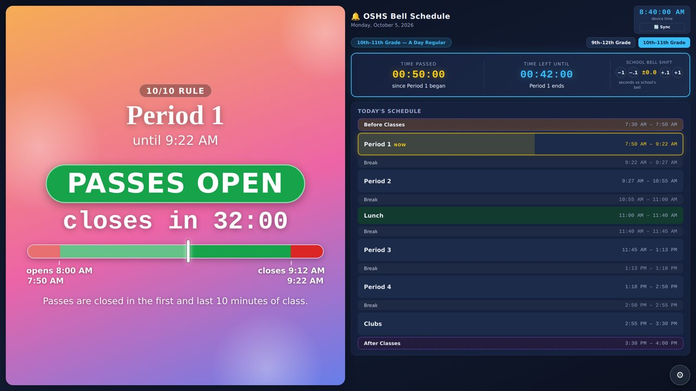
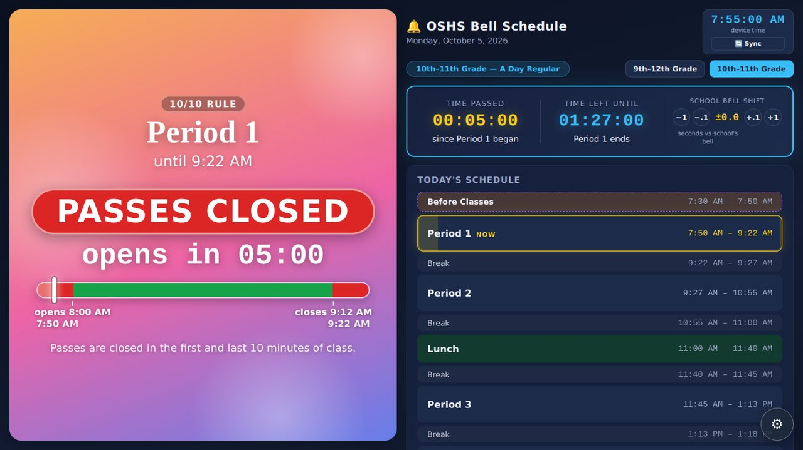

# Hall Pass Board

A classroom screen that shows the bell schedule, a live progress bar for the class period, and the **10/10 hall pass rule**:
passes are closed during the first and last 10 minutes of class, open in between, and the screen says so in big letters.

**Open it here:** https://orlandoscience.github.io/hallpass/
**Try the demo (fast clock, no setup):** https://orlandoscience.github.io/hallpass/?demo=1 (or press *Just look first* on the welcome screen, or *Try the demo* in the Quick start guide)

| Passes open | Passes closed |
|---|---|
|  |  |

## For teachers: start in three steps

1. Open the address above on the classroom screen (Chrome works best). Double-tap an empty spot to go full screen.
2. The first time, a short welcome asks three things: your schedule (9th-12th or 10th-11th grade), the 10/10 minutes (change them if your rule is different), and a PIN for the settings (or no PIN).
3. That's it. The A/B day and the bell times are worked out by the page itself.

**What the colors mean**

| Color | Meaning |
|---|---|
| Green | Hall passes are open. The countdown shows when they close. |
| Red | Hall passes are closed (first and last minutes of class). The countdown shows when they open. |
| Blue | Passing period or lunch. The countdown shows when the next class starts. |

The **pass indicator** ("PASSES OPEN, closes in 20:27") is always the small one at the top of the left panel, so it is only an indicator of whether the restrooms may be used. The top of the right half shows the teacher's **name and room** between the title and the clock; both come from the school's list when the teacher code is checked and can be changed in the settings (*Teacher code and hall pass log*).

**Sounds from the `sounds/` folder:** put `.mp3` files (also `.wav`, `.ogg`, `.m4a`) into the `sounds` folder of the repository (Add file -> Upload files). They appear **by themselves** in every sound list of the board, under "School sounds" (Settings -> Notifications, Attention Signal), named after the file. The page reads the folder from GitHub (and refreshes it every few hours, or at once with *Refresh school sounds* in the Sound Library section); an optional `sounds/index.json` with a list of file names is used when the folder cannot be read from GitHub (for example on another web server). Each board saves the files it uses, so they play without internet. Only use sounds you have the right to use.

**Announcements and questions (your own):** switch on *Announcements* or *Questions* in the settings, write them there and tick the lessons they are for; *Save to the school sheet* keeps them under your name on the school's sheet (administrators can read them). Announcements are a card on the left; for a lesson that has your questions, the question card uses them instead of the general ones. **Preferred names:** in *Settings -> Preferred names* a teacher can suggest the name a student wants to be called (last 4 digits of the ID, look up, type, send); it is used on all boards after an administrator approves it. In the settings nothing is ever wider than its own section: a long text in a list is cut with ...

**Substitute teacher:** tap the teacher's name at the top of the right half, enter the PIN (or the master code), then the substitute's name (choose from the school's teachers or type one) and optionally the room and ticks for the other lessons of that day. It shows at the top in colour for its lessons and is written in the log (columns *Substitute* and *Sub room*).

**Lunch and classes with two times:** lunch is a section too (in the cafeteria it belongs to the teacher *Lunch*, in a classroom to that room's teacher). For a class whose students have two different times (block 3), passes are closed for everybody in every red zone of the lesson bar, and the list of names shows only the students who are in the room by their own time.

**Guests:** in the *Someone else* window, type the last 4 digits of a student's ID and press *Look up* to get the name (and the ID for the log), or type a name.

**Timer (optional):** switch on *Timer* in the settings. It sits in the middle cell of the top row on the left (the top row always has three cells: the pass indicator 30%, the timer 40%, the weather 30%; an unused one is just empty). Set the time in the settings (closing the settings only shows it, it does not start it). On the board: tap to start, tap to pause, tap to resume. When it shows 00:00, or when you hold it, a convenient editor opens: quick choices (1, 2, 3, 5, 10, 15, 20, 30 minutes, changeable), the last used times, -1 min / -10 s / +10 s / +1 min / +5 min and a number pad that works like a microwave (1 5 0 0 = 15:00). The cell turns reddish when the time left is below the threshold you set (60 s by default; the number has min / sec buttons) and pulses when time is up. The timer has **two sounds of its own**, each with its own list (the built-in ones and the school sounds), volume and Test button: one when the time is up (on by default) and one at the moment it turns red (off by default, plays once). They work whenever the timer is on, whatever the Sound alerts switch says.

The **lesson bar** sits in its own cell at the bottom of the left panel, under everything else (cards, agenda note), above the pass buttons. It shows the whole class period: red zones are the closed minutes, the white marker moves as time passes, and the times under it say when passes open (green) and close (red). An ordinary class has two red zones. A class whose students have different times (block 3, when the two lunch groups share a room, such as Dual Enrollment) shows **four**, one pair for each group, and a strip that says which grades are in the room: for example *12th grade / 12th + 10th grade / 10th grade*. That information comes from the school's schedule, so it needs the teacher code.

**Agenda note (optional):** switch on *Agenda note* under Extras, then type the plan for each class (A1, B2...) in the settings, one item per line. Students see it on a yellow lined note with a red pin during that class and a few minutes before it. On the basic screen the note and the big timer take turns; with the rotating cards on, the note is one of the cards and gets the same time as the others. Start a line with `[x]` to cross it out.

**If the school bell and the board disagree:** line the board up with the bell using the -1 / +1 buttons on the main screen, then open the settings, *School bell drift*, and press *Remember the current shift*. The board then adds the bell's daily drift (0.6 seconds a day by default) by itself, so nobody has to nudge it again. After the school puts its bell right, press *The bell was just reset*.

The board keeps working without internet once it has been opened online, and it installs like an app (Chrome menu, "Install"). It checks for a newer version by itself and loads it after school, never in the middle of class.

## Extras (all off until you switch them on) and the screen

**Cancelling a pass always needs a PIN**, even when the PIN for the settings is switched off: the board's PIN or the master code (if no PIN is set at all, only the master code works). **The proportion** between the left and the right part is set in *Display* (*Left part width*, 40-60%).

Open the settings by double-tapping the gear button (bottom right), then your PIN if you use one (the PIN can be switched off in the settings). **Every section is always visible; the switch next to its name turns it on or off** (an off section is greyed and locked, and its extra is not used). The extras:

- **Hall pass buttons and log** (two buttons to start with; they work only after the teacher code is typed, see below): students tap their name and choose where they are going (the *Leave class* button then counts down 5 seconds and the student leaves by himself; every new tap on a place starts the count again; the seconds are a setting, 0 = off), and tap again when they return. Any number of pass buttons. Each place (restroom, locker, water...) has its own limit in minutes; the pass turns red on the board after it (limits stay on the board and are not sent anywhere). A pass can be undone for 30 seconds without the PIN; after that it is cancelled with the PIN (or one confirmation if the PIN is off). Undone and cancelled passes stay in the log as Cancelled, with the time of the tap. Long class lists (study hall) are chosen by first letter. Optionally a teacher may allow passes in the closed 10/10 minutes: the board asks once, then it looks like any other pass and the log notes it. Trips can be saved to your own Google Sheet.
- **Sounds**: warnings before the bell and a bell ring.
- **Cards**: a rotating panel with the lesson phase, a day arc, facts, quick questions with answers, announcements, school calendar numbers and the Orlando weather (temperatures in degrees F with C in brackets, plus weather warnings).

`Quick setup -> Basic` brings back the simple screen at any time.

## For whoever looks after this repository

**Publishing.** The page is plain files, no build step.

1. Upload everything in this folder to the repository (Add file -> Upload files; drag the folders in too) and commit to `main`.
2. Repository **Settings -> Pages -> Build and deployment**: Source *Deploy from a branch*, Branch `main`, folder `/ (root)`, Save.
3. After a minute the board is live at `https://<user>.github.io/<repository>/`.

**Updating.** Replace `index.html` and change the version text in the line `const APP_VERSION = "..."` so that boards know there is something new. Boards pick it up by themselves after school hours.

| File | What it is |
|---|---|
| `index.html` | The whole board (page, bell schedules, A/B calendar). |
| `sw.js`, `manifest.webmanifest`, `icon*.png/svg` | Make it work offline and installable. |
| `LICENSE` | The OSHS Free Use License. |
| `apps-script/Code.gs`, `apps-script/SETUP.md` | The school's Google Apps Script (teacher codes, class lists, the log, announcements, weather warnings) and the administrator's guide. |
| `apps-script/webapplink` | The address of the deployed script. **The page reads it from here when it starts** (one line, ends with `/exec`; lines starting with `#` are comments; empty = nobody is connected yet). |
| `docs/` | Screenshots and QR codes of the page address, for slides (the page itself no longer makes QR codes). |

**Teacher codes, class lists and the hall pass log**

The hall pass buttons need to know whose board this is. Each teacher has a personal **teacher code**, made by the administrator in the school's Google Sheet. The code is typed once on the board (welcome screen, or Settings -> *Teacher code*), or arrives in a personal setup link that ends in `#code=...`. Without a code the buttons stay grey, no student names are loaded and nothing is logged. With a code the board receives only the students of that teacher's own classes (from the school schedule) and logs each finished trip **by student ID**, one row on the single `Log` tab of the school's sheet.

The administrator's guide is in [`apps-script/SETUP.md`](apps-script/SETUP.md). In short: paste `apps-script/Code.gs` into the sheet's Apps Script, deploy it as a web app (write the address into `apps-script/webapplink`, the page reads it from there; deploy a *new version* of the same deployment to keep the address), then use the menu *Hall Pass*: set up tabs, import the schedule export, make teacher codes, make setup links.

## License

Hall Pass Board is free for **Orlando Science High School (OSHS)** only. Copyright (c) 2026 Shamil Ganiev. OSHS and its staff may use, copy and modify it for the school's own purposes, must keep the author's name and may not sell it. Any other school or organization needs the author's written permission first (the code is visible so that OSHS staff, students and parents can see how it works, which is not a license). The full text is in [LICENSE](LICENSE). This is a plain-language license, not a legal opinion: the school may want its own counsel to read it.

## Privacy

- Everything is stored in the browser of the board itself (IndexedDB). Nothing is sent anywhere until the teacher code is typed (and then only the student ID, the destination and the times), or you switch on the weather.
- **This repository and the website are public. Never commit student names, rosters, schedule exports or teacher codes.** The address of the school's script is public on purpose: it answers nobody without a valid teacher code. Names live only in the school's Google Sheet and, for each teacher's own classes, on that teacher's board.
- The weather extra contacts open-meteo.com and api.weather.gov (through your Google script). There is no time synchronisation: the board uses the clock of the device, plus the usual bell shift buttons (and the optional *School bell drift* section).
- Forgot the PIN? Clear the site's data in Chrome (site settings) and the welcome screen returns. This also clears that board's saved settings.

## Credits

The handwriting font is Patrick Hand (SIL OFL, see `THIRD_PARTY_NOTICES.md`). Weather data: Open-Meteo.com. Warnings: U.S. National Weather Service.
